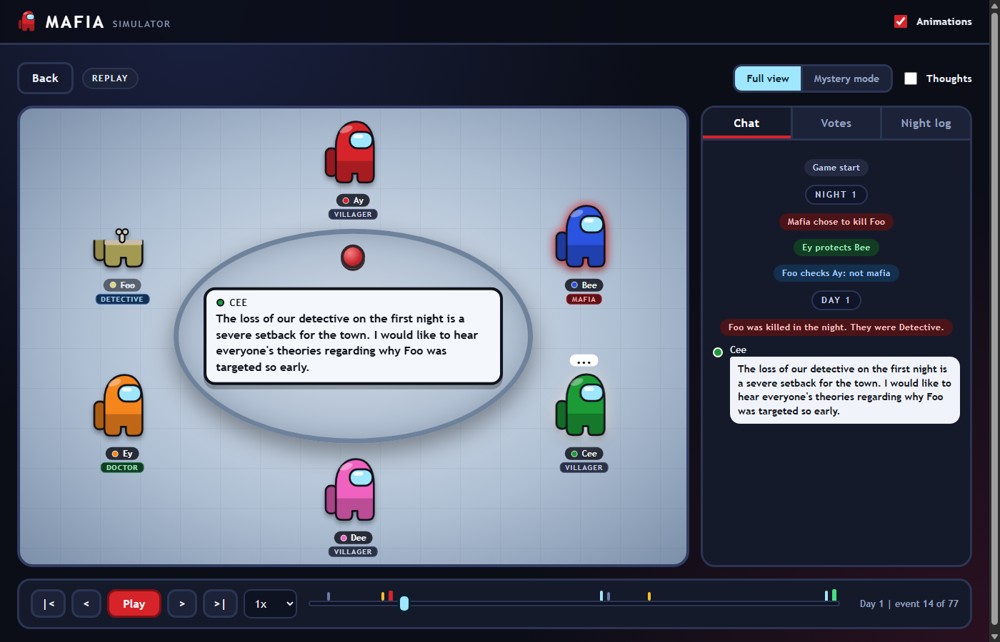
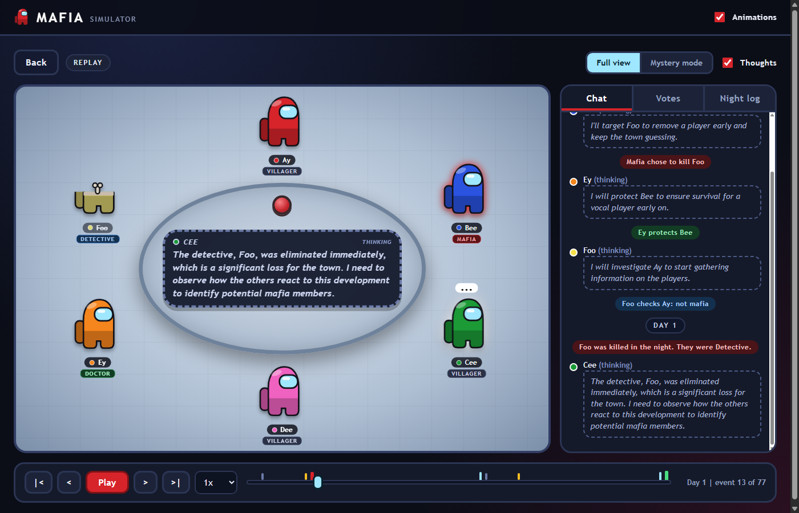
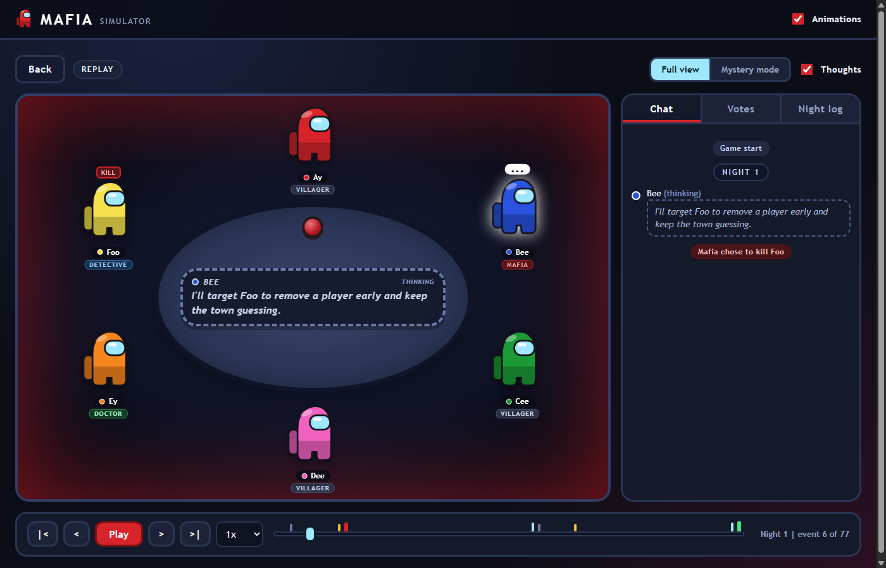
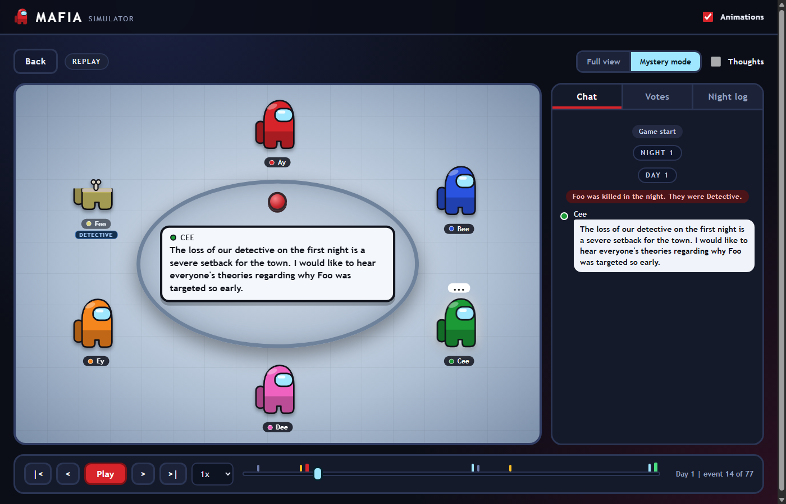
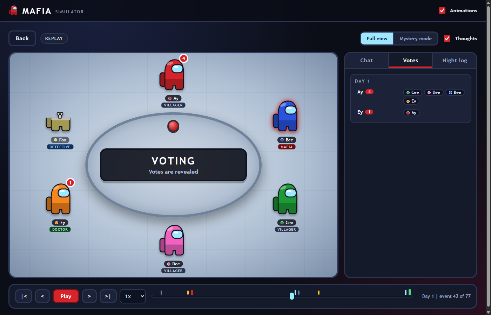
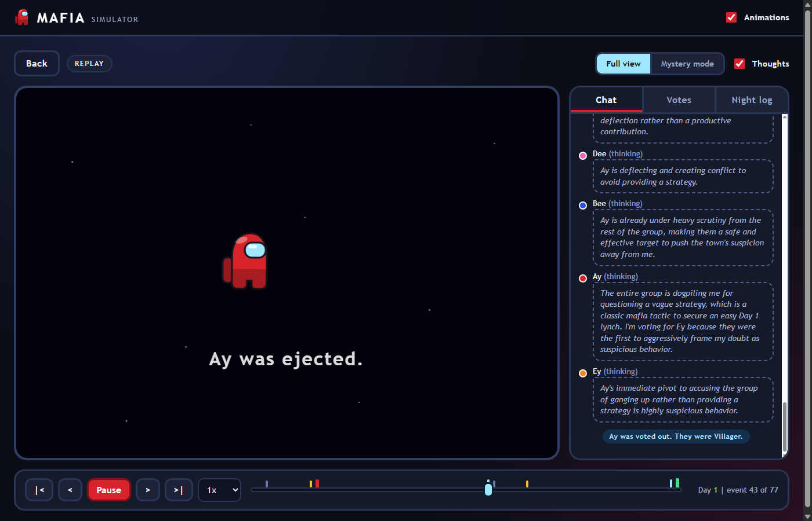
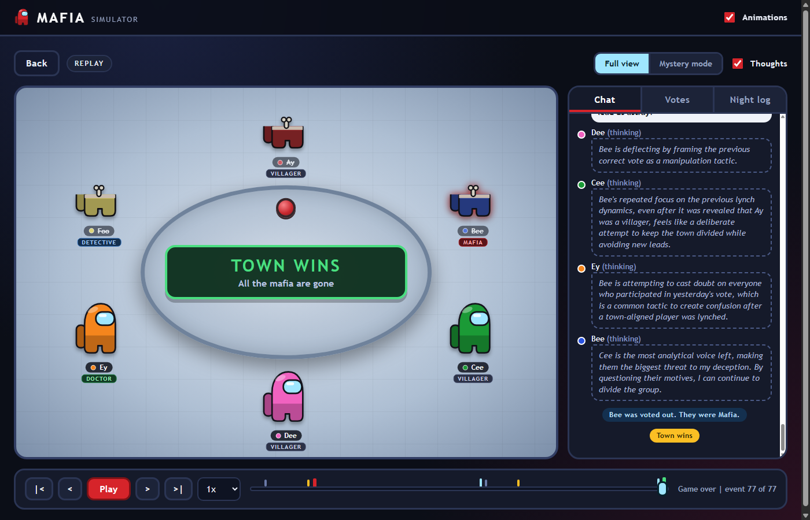
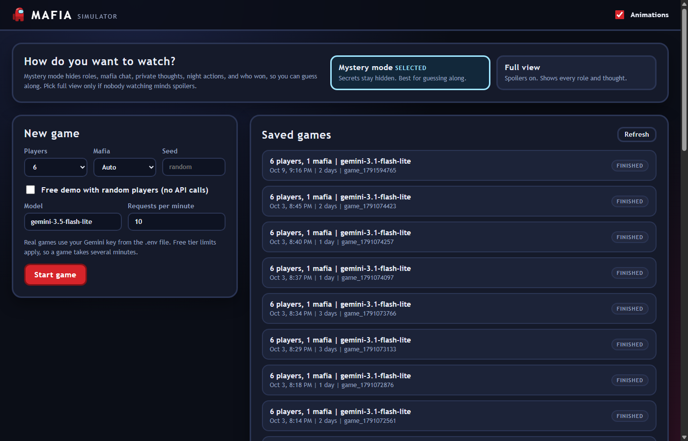
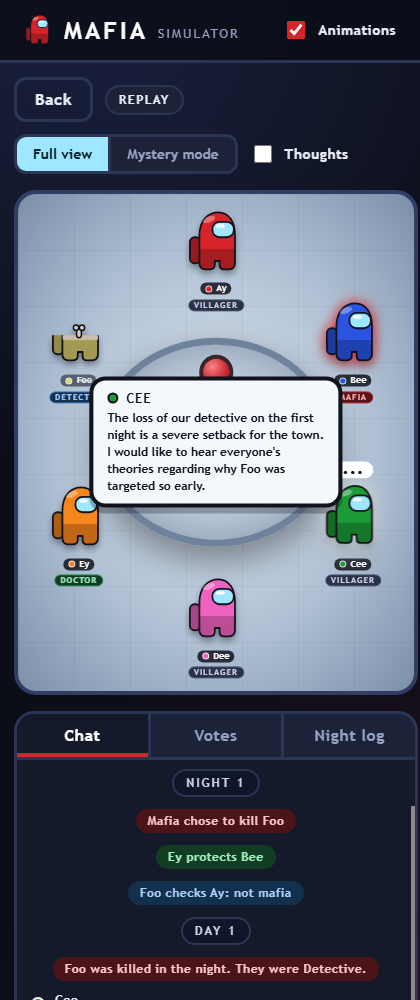

# Mafia Simulator

A game of Mafia played entirely by AI players, with a browser viewer so you can watch it unfold. The players are large language models that talk, bluff, scheme in a private night channel, and vote each other out. The viewer draws the game as a crew around a cafeteria table, in the style of Among Us.

The project also measures how well the players reason. The question it asks is not who wins, but whether each decision was logical given what that player knew.



## Results at a glance

Thirty real games were judged for logic, not wins. Full numbers, methods and caveats are in [docs/QUALITY_REPORT.md](docs/QUALITY_REPORT.md), including section 2.7, which lists what improved, what regressed, and what stayed about the same.


Mafia and detective play is mostly sound. Villager play is the weak spot, because early in the game there is little evidence to reason from.


The doctor fix was tested by replaying real prompts, and is not yet adopted in the game itself.
## What you get

* **A rules engine that does not use any AI.** It runs the night and day phases, resolves kills and saves, counts votes, and decides who won. It is deterministic for a given seed and is tested without any model calls.
* **LLM players.** Each player is prompted with only what that player is allowed to know. Gemini is supported out of the box, through a small OpenAI compatible client that also works with Groq, Ollama, and OpenRouter.
* **Private channels.** The mafia chat in secret at night and must agree on one target. The doctor and detective act alone. Every player also produces private reasoning, which the game never shares.
* **A live and replay viewer.** Watch a game as it is generated, or replay any saved game with play, pause, step, speed control, and a timeline you can drag.
* **Spoiler safe by default.** The lobby asks how you want to watch. Mystery mode is the default and hides roles, mafia chat, private thoughts, night actions, and even who won in the saved games list. Full view is one click away.
* **A free demo mode.** Random players let you try the whole viewer without an API key or any cost.
* **Tools to measure reasoning quality.** A batch runner, a leak audit that checks every prompt, hard logic checks, and a judge model that rates each key decision. The methodology and the findings are written up in [docs/QUALITY_REPORT.md](docs/QUALITY_REPORT.md).

## Screenshots

**Private reasoning.** Full view shows each player's hidden thoughts as dashed cards, next to what they say out loud.



**Night.** The scene goes dark with an alarm glow. Full view shows the mafia kill, the doctor save, and the detective check as marks over the players.



**Mystery mode.** Roles, mafia chat, thoughts, and night actions are hidden, so you can guess along. A role is revealed only when a player dies or the game ends.



**Votes.** Votes are secret until everyone has voted, then revealed together. The Votes tab keeps a tally for each day.



**Ejection.** A vote out plays a short animation and reveals the role.



**Victory.** The game ends with a banner, and every role is revealed.



**Lobby and phone layout.** Pick how you want to watch, then start a game from the form or open a saved game. The layout works on a narrow screen too.

<p>
  
  
</p>

## Quick start

You need Python 3.10 or newer. There is nothing to install, because the project uses only the standard library. A browser is needed only for the viewer.

**1. Try the viewer for free (no key needed)**

```
python serve.py --open
```

Tick "Free demo with random players" and press **Start game**. The page opens the game as it plays. Demo players pick random moves and say placeholder lines such as "I am Ay, day 1", so the game shows a **DEMO PLAYERS, NO AI** badge. The box is ticked by default only when no API key is found, and the page remembers your last choice.

**2. Play a real game with Gemini**

1. Get a free key at https://aistudio.google.com.
2. Copy `.env.example` to `.env` and paste the key after `GEMINI_API_KEY=`.
3. In the viewer, untick the demo option and press **Start game**, or run it from a terminal:

```
python run.py --players 6 --seed 1
```

A 6 player game takes about 30 to 40 model calls. The free tier limits requests, so expect a few minutes per game. The default is 10 requests per minute, which you can change with `--rpm` or on the setup form. The default model is `gemini-3.5-flash-lite`.

> Model names and free tier limits change. If you get a 404 from the API, look up a current model name in AI Studio and pass it with `--model`. A daily quota error stops a game at once instead of retrying, and the limit resets the next day.

**Free tier budget.** The lite models used as players allow about 500 requests per day each, which is roughly 10 games. The stronger models used as judges allow only about 20 requests per day each. Quotas are per model, so a second model gives a fresh budget. Do not start a viewer game while a batch is running, because they share the same quota.

## Using the viewer

Start it with `python serve.py` and open http://127.0.0.1:8765/. Opening the page while a game is running attaches you to that game.

| Control | What it does |
| --- | --- |
| Full view and Mystery mode | Chosen in the lobby, and Mystery mode is the default. Full view shows everything. Mystery mode shows only what the players can see. Switching to full view during a game asks you to confirm. |
| Thoughts | Shows or hides each player's private reasoning in full view. |
| Play, step, and speed | Playback runs at reading pace. Speeds go from 0.5x up to Max. |
| Timeline | Drag to any moment. Marks show nights, days, kills, ejections, and the end. |
| Stop game | Ends a running game early. |
| Animations | Follows your system reduce motion setting until you change it here. |

Keyboard: **Space** plays or pauses, and the **left and right arrows** step through the game.

Links can point at an exact moment, for example `http://127.0.0.1:8765/#game=game_1790708310&at=13&paused=1&mode=mystery&tab=votes`. The options are `game`, `at` (event number), `paused`, `mode` (`full` or `mystery`), `tab` (`chat`, `votes`, or `nights`), and `thoughts` (`0` or `1`).

## Command line

```
python run.py [--players 6..10] [--mafia N] [--seed N] [--model NAME] [--rpm N] [--random] [--log-dir DIR]
python serve.py [--port N] [--log-dir DIR] [--open]
```

| Option | Meaning |
| --- | --- |
| `--players` | Number of players, from 6 to 10. |
| `--mafia` | Override the mafia count. The default depends on the player count, see below. |
| `--seed` | Makes role assignment and the first day's speaking order repeatable. The model's replies are not repeatable. |
| `--model` | Model name for the LLM players. |
| `--rpm` | Cap on requests per minute, to stay inside a free tier. |
| `--random` | Use free random players and make no API calls. |
| `--log-dir` | Where game logs are written. The default is `logs`. |

The evaluation tools are described under [Measuring quality](#measuring-quality).

## The rules

Roles are Villager, Mafia, Doctor, and Detective. There is always one Doctor and one Detective. The default mafia count is 1 for 6 players, 2 for 7 to 9 players, and 3 for 10 players. Players are named in seat order: Ay, Bee, Cee, Dee, Ey, Foo, Gi, Himothy, Ivy, and Jojo.

**Night**
1. The mafia chat in private if there are two or more of them, then vote on one target. If they disagree they vote again, up to three rounds, and a random choice breaks a final tie.
2. The Doctor protects one player. A protected player survives a kill.
3. The Detective checks one player and learns whether they are mafia.

**Day**
1. Deaths are announced. A dead player's role is revealed.
2. Everyone speaks for two rounds, in an order that is shuffled each day.
3. Everyone votes in secret. Votes are revealed together, and the player with the most votes is ejected. A tie ejects nobody.

**Winning.** Town wins when all mafia are dead. The mafia win when they are at least as many as the town.

## How it works

```
Game engine  ->  Event stream  ->  Viewer
   |                 |
   |                 +-> logs/game_*.jsonl and logs/trace_*.jsonl
   +-> asks Agents (LLM or random) for actions
```

* **The engine only trusts validated actions.** An agent returns a speech or a target. Anything invalid is retried, then replaced with a safe default, so a bad model reply cannot break a game.
* **Information hiding is structural.** Every event carries an audience. `view_for()` builds each player's view from the events that player may see, and agents receive nothing else. Tests assert that a villager never sees mafia chat or roles, and `audit.py` re-checks every real prompt after the fact.
* **The spectator has a special event.** The `setup` event holds all roles and is visible to nobody in the game. The viewer and the log can see it, and no agent can.
* **Private thoughts.** A player's reasoning is logged as an event only that player can see. It is never shown to the others.
* **Lists are shuffled in the prompts.** The list of valid targets, and the list of who is alive, appear in a different order for every request. Models lean toward the first name in a list, and a batch of real games showed the detective checking the first listed player 85% of the time against 21% by chance. The shuffle removed that bias for gemini-3.5-flash-lite. It did not for gemini-3.1-flash-lite, whose mafia still picked the first listed target 58% of the time, so the bias is model specific.
* **The viewer is a function of the event list.** Everything on screen at a point in the game is computed from the events up to that point. That is why the timeline, replay, and live mode all work the same way. Live mode is just a replay of a list that is still growing.
* **The LLM client** uses only the standard library. It caps requests per minute, backs off on rate limit and server errors, counts tokens, and caches responses on disk in `.cache/llm` so an interrupted game or batch does not repeat its calls. Delete that folder, or use `--no-cache` on `batch.py`, if you want fresh answers for a prompt you have already run.

## Measuring quality

The goal is to know whether the players reason logically, not who wins. A win can come from a bad vote that happened to land. So each decision is judged against only what that player knew when they made it. There are three layers, from most mechanical to most judgmental.

1. **Leak audit.** Checks every saved prompt: each line of game history must be an event that player was allowed to see.
2. **Hard logic checks.** No AI involved. Did the doctor vote for a player their own protection proved was town? Did the detective act on their own results? Are statements about the public record true? Does a vote's reasoning name the player voted for, and what does it rest on?
3. **Judge review.** A stronger model rates every key decision sound, weak, or illogical, against only that player's knowledge. The hard checks act as its answer key, and several judges are compared with each other.

```
python batch.py --games 10 --seed-start 100 --rpm 10 --summary logs/batch_main.json
python audit.py logs/batch_main.json
python judge.py logs/batch_main.json --max-games 6
python analyze.py logs/batch_main.json
python analyze.py logs/batch_new.json --baseline logs/batch_main.json
python compare_judges.py logs/judge_batch_main.json logs/judge_other_batch_main.json
```

| Tool | What it does |
| --- | --- |
| `batch.py` | Plays N games with consecutive seeds and saves a summary after every game, so an interrupted batch resumes. It stops after two failed games in a row. Options: `--games`, `--players`, `--mafia`, `--seed-start`, `--model`, `--rpm`, `--random`, `--no-cache`, `--summary`, `--log-dir`. |
| `audit.py` | The leak audit over one or more batch summaries. Exits with an error if it finds a leak. |
| `judge.py` | Has a judge model rate every key decision in a batch. Options: `--model` (default `gemini-3.5-flash`), `--max-games N` (judge only the first N seeds), `--rpm`, `--out`. It saves after each game and resumes. Use a different model from the players. |
| `analyze.py` | Writes a report for a batch, leading with reasoning quality. Options: `--baseline` to compare with another batch, `--judge` and `--baseline-judge` to include judge verdicts, `--out`, `--log-dir`. |
| `compare_judges.py` | How much two judges agree: same verdict, agreement on sound against not sound, and Cohen's kappa. |
| `ablate.py` | Tests a prompt change by replaying real prompts from the saved games with and without it. See [Testing a fix by replay](#testing-a-fix-by-replay). Options: `doctor` or `villager`, `--samples`, `--model`, `--note-arm`, `--max-cases`, `--judge-model`, `--judge-pairs`, `--out`. |

The report covers the hard checks and the judge review first, then reliability, role secrecy, writing quality, and bias in night choices. Win rates are included but labelled as not a quality measure. A batch of 10 games takes roughly 30 to 60 minutes at the free tier rate.

The latest findings are in [docs/QUALITY_REPORT.md](docs/QUALITY_REPORT.md), which also has the full methodology, including the judge's instructions word for word and the weaknesses of the method. Running notes on every experiment are in [docs/DEVLOG.md](docs/DEVLOG.md). In the first 30 real games there were no information leaks and no invalid actions, genuine contradictions were rare, the one clear failure was a doctor ignoring what a blocked kill proves, and the main weakness was thin evidence in villagers' day votes.

### Testing a fix by replay

A batch of games is too slow to test a rare mistake. `ablate.py` takes the real prompts from the saved traces where a weakness showed up, asks the model again many times with and without a candidate fix, and compares. The situation is identical in both arms, so any difference comes from the change. Replies are fresh (the cache is off), and results are saved per prompt so a quota stop resumes.

```
python ablate.py doctor --note-arm --samples 8
python ablate.py villager --model gemini-3.1-flash-lite --samples 5 --max-cases 18 --judge-model gemini-3.8-flash --judge-pairs 18
```

**Results so far** (the full method, tables, and the exact instructions are in [docs/QUALITY_REPORT.md](docs/QUALITY_REPORT.md), section 2.6):

| Weakness | What was tested | Result |
| --- | --- | --- |
| The doctor voted out a player their own protection had proved was town (2 of 19 doctor votes in the games) | A general rule in the system prompt | Mistake went from 14.8% to 7.8% of votes, not significant (p = 0.13). It fixed one of the two prompts where the mistake occurs and left the other untouched. |
| | The doctor's own conclusion stated as a fact in their notes ("you protected X on a night when nobody died, so X is NOT mafia") | **16 of 108 votes to 0 of 108** (p = 0.00002). It fixed both prompts. |
| Villagers' day votes rest on thin evidence (only 20.6% of villager decisions rated sound) | An instruction to name a concrete fact before voting, and never to invent one | A blind judge preferred the hinted reply in 7 of 7 decisive pairs (7 more were ties), and flagged no invented facts. A text pattern measure saw no change (59.1% against 53.8% concrete), and abstentions halved (24 to 12 of 90). |

Neither fix is built into the game yet. The doctor note holds only what the doctor already knows, so it is a safe aid, but it does the inference for the model, not teaches it. The honest limits: the doctor result rests on two prompts, a replay is one decision and not a game, and the villager judge's criterion matches the instruction being tested. The next step for each is a full batch.

## Project layout

```
mafia/
  engine/      state.py, rules.py, visibility.py, game.py, errors.py
  agents/      base.py, llm_agent.py (prompts and parsing), scripted.py (random players)
  llm/         client.py (rate limited, cached, OpenAI compatible)
  web/         server.py (HTTP and live stream), runner.py (runs one game at a time)
  batch.py     plays a batch of games
  analysis.py  scores a batch (reliability, role play, writing, bias) and builds reports
  logic.py     hard logic checks
  audit.py     the leak audit
  judge.py     the judge model: casebook, rating, agreement between judges
  ablate.py    replay experiments that test a prompt change on real prompts
  charts.py    draws the result charts as SVG
  setup.py     builds agents, loads .env, holds the player names
  eventlog.py  JSON lines log writer
web/           index.html, style.css, app.js, crewmate.js (the viewer)
docs/          QUALITY_REPORT.md, DEVLOG.md, images/
tests/         engine, agents, web server, LLM client, batch, analysis, logic, audit, judge, replay experiments
run.py         play one game in the terminal
serve.py       start the viewer
batch.py       play a batch of games
judge.py       rate decisions with a judge model
analyze.py     report on a batch
audit.py       leak audit
compare_judges.py   agreement between two judges
ablate.py      test a prompt change by replaying real prompts
make_charts.py  rebuild docs/images/chart_*.svg from the logs
```

Each game writes `logs/game_<timestamp>.jsonl`, one event per line. Real LLM games also write `logs/trace_<timestamp>.jsonl` with the full prompts and replies, which the audit and the bias checks read. Trace files contain every player's hidden information, so keep them private. Batches write `logs/batch_*.json` and judge runs write `logs/judge*_*.json`.

## Tests

```
python -m pytest
```

157 tests cover the rules, win conditions, vote ties, visibility, the LLM agent and its prompts, the LLM client's retry and quota handling, the web server and its security checks, batches, every analysis tool, and the replay experiments and the SVG charts. The leak audit is tested by injecting four kinds of leak and requiring each to be caught, the judge is tested with a scripted judge, and the replay experiments check that only real situations become cases and that the judge comparison is blinded. None of the tests call a real model.

## Security notes

The viewer is meant for your own machine. The server listens on 127.0.0.1 only. It rejects requests with an unexpected Host header, and start and stop requests need a custom header and a local origin, so another website open in your browser cannot start games and spend your API quota. Your API key stays on the server and is never sent to the page.

## Known limits and next steps

* **Players do not learn between games yet.** Memory across games, with notes on each opponent, is the next feature to build.
* **The evidence is small.** The quality findings rest on 30 games and 196 judged decisions from two models of one provider, so differences of a few decisions between batches are noise. Whether the option shuffle or the second model improved reasoning is not established.
* **The judges are language models,** from the same provider as the players, and there are no human ratings. They agree closely with each other and with the mechanical checks, but they share blind spots.
* **Two fixes are tested in replay but not adopted.** Stating the doctor's own conclusion as a fact removed the doctor's mistake, and an instruction to name a concrete fact was preferred by a blind judge for villagers. Each still needs a full batch to confirm it improves real games without side effects.
* **A smaller preference for the earliest seat names** remained in night actions after the shuffle. The players have since been renamed, so it is not yet known whether it came from the old names or the seat order. Games played before the rename are not directly comparable to games after it.
* **Personas are only a speaking style.** Earlier versions gave players attitudes such as paranoid or contrarian, and that made the town play worse, so styles now change only how a player writes.
* **Only Gemini has been tested.** Other OpenAI compatible providers should work by changing the base URL and key, but that is unverified.

## Credits

The characters are original SVG drawings inspired by the look of Among Us. No official artwork is used. Among Us is a trademark of Innersloth.
