# Quality report: do the players reason logically?

Written 2026-10-03. The question is not who wins. It is whether the AI players decide logically, given what each of them knew when they decided.

**Contents:** [Bottom line](#bottom-line) | [1. Methodology](#1-methodology) | [2. Results](#2-results) | [3. What needs action](#3-what-needs-action) | [Appendix A: the judge's instructions](#appendix-a-the-judges-instructions-verbatim) | [Appendix B: what the judge reads](#appendix-b-what-the-judge-reads) | [Appendix C: text patterns](#appendix-c-text-patterns-used-by-the-automatic-checks) | [Appendix D: the instructions tested](#appendix-d-the-instructions-tested-by-replay)

## Bottom line

* **Reasoning is mostly sound where it can be checked mechanically, and genuine contradictions are rare.** Across all 30 games (390 decisions), the primary judge rated 1.8% of decisions illogical, which is 7 decisions. The most serious was a doctor voting out a player his own protection had proved was town, which happened twice, both in the shuffled `gemini-3.5-flash-lite` batch.
* **The real weakness is thin evidence in day votes, mostly from villagers.** The judge rated only 44.7% of day votes sound and 52.7% weak. Villagers' decisions were sound 20.6% of the time and weak 76.5%. In 110 of the 127 decisions rated not sound, the reason was an unsupported accusation. Players accuse each other of being defensive, evasive, or too eager, and that is often all they have.
* **The mafia's deceptions hold up** (98% sound), and so do the detective (79%) and the doctor (72%).
* **The option shuffle removed the list position bias for `gemini-3.5-flash-lite` but not for the second model's mafia kills** (57.9% went to the first name listed, against about 25% by chance), and both models still lean on the earliest seat in night actions (36% to 69%, against about 22% by chance). Night choices are partly arbitrary.
* **Neither the option shuffle nor the second model measurably changed the quality of reasoning.** Judged on all 30 games, 64.1%, 69.7%, and 68.8% of decisions were sound across the three batches, which is within noise. An early look at only the first three seeds suggested a large improvement, and it did not hold up on the full set.
* **The two weaknesses were tested by replaying real prompts, with these results (section 2.6).** Stating the doctor's own conclusion as a fact in their notes ("you protected X on a night when nobody died, so X is NOT mafia") removed the mistake: 16 of 108 votes before, 0 of 108 after. A general rule in the system prompt fixed only one of the two prompts where the mistake occurs. For villagers, telling them to name a concrete fact before voting was preferred by a blind judge in all 7 decisive pairs (7 more were ties) with no invented facts, but a text pattern measure saw no change, and it halved abstentions. Neither fix is adopted into the game yet.
* **No information leaks between players.** 0 leaks in 992 saved prompts across 30 games, within the limits of what the audit can see (section 1.5).
* **The model is reliable.** 0 invalid actions and 0 API errors in 30 real games.
* **Win rates tell us little here.** Town won 9, 6, and 7 of 10 games in the three batches, which is not a quality measure and is far too noisy to read as balance.


---

## 1. Methodology

### 1.1 Question and principles

The target is **logical play**: a decision is good if a competent player holding only that player's information could reasonably make it. Three principles follow, and every measure below respects them.

1. **Outcomes are ignored.** Who won, and whether a guess turned out right, do not count. A correct vote made for a bad reason is still weak, and a wrong vote made for a good reason is still sound.
2. **Each decision is judged against that player's own knowledge.** That is public events plus the player's private knowledge (their own checks, protections, or the identity of their mafia partner). Never against facts the player could not see.
3. **Bluffing is allowed.** The mafia deceiving the town is sound if it serves their team, so lying about one's own role is never counted as an error.

The evidence is gathered in three layers, from most mechanical to most judgmental:

| Layer | What it answers | Uses an AI model |
| --- | --- | --- |
| Leak audit | Was any player shown information they should not have had? | No |
| Hard logic checks | Did a decision contradict what the player provably knew, or a statement contradict the public record? | No |
| Judge review | Was each key decision reasonable, thin, or illogical, given what the player knew? | Yes |

Each layer has a different blind spot, which is why all three are used (section 1.12).

### 1.2 Study design

**Conditions.** Three batches of 10 games, all with 6 players (1 mafia, 1 doctor, 1 detective, 3 villagers), seeds 100 to 109, and an old name roster (Ann, Bob, Cy, Di, Ed, Flo).

| Batch | Players are | Option order in prompts | Run on | Model calls per game |
| --- | --- | --- | --- | --- |
| `batch_main` (baseline) | `gemini-3.5-flash-lite` | Seat order, so the first name listed is always the lowest seat | 2026-09-29 (seeds 100 to 108), seed 109 on 2026-10-03 | 28.0 |
| `batch_shuffle` | `gemini-3.5-flash-lite` | Shuffled differently for every request | 2026-10-03 | 37.6 |
| `batch_model31` | `gemini-3.1-flash-lite` | Shuffled differently for every request | 2026-10-03 | 31.4 |

The only prompt difference between the first two batches is the option order. The third differs from the second only in the model.

**What the seed fixes, and what it does not.** The seed determines the role assignment, which persona (speaking style) each player gets, and, in practice, the speaking order on day 1 (the random generator is shared, so a rare fallback to a random choice can shift it). It does not make a game repeatable: the models sample at temperature 0.8, so a game diverges as soon as the first reply differs, and later random draws (speaking order, tie breaks) shift. Only 5 of 10 seeds ended with the same winner across the baseline and the shuffled batch, so a seed pairs the **starting conditions**, not the games. The pairing reduces variation from who held which role, but it does not make the batches paired replicates.

**Known confounds in the design.**
* The baseline ran four days before the other two batches (except its seed 109). A provider can change how a model is served between days, and this study cannot rule that out.
* Seed 109 of the baseline was resumed from the response cache after a quota failure, so 17 of its calls replayed saved replies.
* The second model replies more slowly (5.4 minutes per game against 3.8), which does not affect the play but is a difference in conditions.
* A few identical prompts were answered from the response cache across games (1 to 3 calls per batch), see 1.5.
* The roster was renamed after these batches. New games are not comparable to them.

### 1.3 The game and the players

**Rules** (the same for every condition). Each night the mafia chat in private if there are two or more of them, then vote on one target, in up to 3 rounds until they agree (a random choice breaks a final tie). The doctor protects one player. The detective checks one player and learns whether they are mafia. Each day the survivors speak for 2 rounds in an order shuffled each day, then vote in secret. Votes are revealed together, and the player with the most votes is ejected, with a tie ejecting nobody. A player's role is revealed on death. Town wins when no mafia remain, and the mafia win when they are at least as many as the town.

**What a player is sent.** Every request is stateless and holds everything the model sees:
* a **system prompt** with the rules, a block of general strategy advice (for example that power roles should stay hidden and reveal themselves only when it helps), the player's name, role and role specific advice, a speaking style (one of 10, such as "dry humor" or "short, plain sentences", which affects only how they write), and, for the mafia, their partner's name;
* a **user prompt** with the last 80 game events that player may see, a line giving the phase, the day and who is alive or dead, and the request (speak, or choose a target).

**What the model returns.** For speech, a JSON object with a private `thought` and a public `say`. For a night action or a vote, a JSON object with a short `reason` and a `target`. The private `thought` or `reason` is logged for analysis and is never shown to any other player.

**Sampling.** Temperature 0.8. Up to 350 tokens for speech and 150 for a target. The engine retries an unusable reply up to 2 more times, then substitutes a safe default (a random valid target, an abstention, or "(says nothing)"). The client waits at least 6 seconds between calls (10 requests per minute), retries rate limits and server errors up to 6 times with growing waits, and fails at once on a daily quota error.

**Option order shuffle** (batches 2 and 3). The list of valid targets, and the "Alive" list, are shown in a different order for every request. The order is reproducible: it comes from a random generator seeded with the player, the day, the phase, the request kind, and the number of events that player can see. This removes a bias toward the first listed name (section 2.4).

**Personas.** Earlier versions gave players attitudes (paranoid, contrarian), and that made town play worse, so the 10 styles now change only how a player writes.

### 1.4 What was recorded

* **Event log** (`game_<id>.jsonl`): every event, in order, with its audience (public, or the list of players who may see it) and structured data (speaker, message, voter, target, role, cause of death). A special `setup` event holds every player's role and has an empty audience, so no player ever receives it.
* **Prompt trace** (`trace_<id>.jsonl`): the exact messages sent and the exact reply received for every model call, including calls answered from the cache.
* **Batch summary** (`batch_*.json`): per game, the seed, winner, days, roles, calls, cached calls, tokens, invalid actions, API errors, and duration.
* **Judge verdicts** (`judge*_*.json`): the judge's rating of every decision, with its reason and tag.

### 1.5 Leak audit

**Goal.** Confirm that nothing a player was sent is information they should not have had.

**Method.** For each game, build for each player the set of history lines they were entitled to: every event that is public or lists that player in its audience, formatted exactly as the prompt formats it (`[phase day] text`). The `setup` event is excluded for everyone. Then read every saved prompt, extract its game history lines, and require each line to be in the sending player's set. Two more checks per prompt: the role named in the system prompt must equal the player's true role, and the "fellow mafia" list must equal the true mafia (and be empty for everyone else).

**Validation.** The audit's tests inject four kinds of leak (mafia chat into a villager's prompt, another player's private thought, the spectator only roles line, a wrong role) and require each to be caught. A clean game must report none.

**What it cannot see.**
* It verifies delivery against the audience tags in the log. If an event were tagged public by mistake when it should have been private, the audit would accept it. The tagging is covered by the engine's own tests, not by this audit.
* It checks history lines, not the system prompt's rules text or the state line, and it cannot detect a leak written as a line that is otherwise allowed.
* It cannot see leaks through the model itself. All players are the same model, so mafia could in principle give themselves away through tells in their public speech. A separate, weak check on that is in 2.1.

**The response cache.** The cache key covers the model, the whole message list, and the sampling settings, so a reply is only reused for a word for word identical prompt. That means one player's reply is never served to another. It does serve the same reply to two different games when the prompt is identical (for example `Di the detective` with the same persona on night 1), which carries no extra information but makes those two choices non independent. To find them, every prompt in a batch was hashed and compared across games.

### 1.6 Choice bias (position and seat)

**Goal.** Detect choices driven by where a name appeared, not by reasoning.

**Method.** For every night action (mafia kill, doctor protection, detective check) and every day vote that named a target, record whether the chosen player was **first in the list shown in the prompt** (read from the prompt trace by parsing the "Options:" list and the reply's target), and separately whether they were the **earliest seat** (first in roster order). Compare each rate with the rate expected by chance: for each decision, 1 divided by the number of valid options, averaged over decisions. Abstentions are excluded.

**Why two measures.** Before the shuffle, the prompt order and the seat order were the same, so they could not be told apart. After the shuffle, the first listed name measures list position, and the earliest seat measures a preference for certain names or seats.

### 1.7 Hard logic checks

These use only the event log. They are deliberately conservative: they count only what the log can settle, and they would rather miss a mistake than invent one.

| Check | Definition |
| --- | --- |
| **Doctor voted a provably town player** | A player is *proved town to the doctor* when the doctor protected them on a night, the mafia's final target that night was that same player, and nobody died. A blocked kill means the mafia aimed at that player, and the mafia never target their own partner, so that player is not mafia. A violation is the doctor voting to eject such a player while they are alive. The opportunity count is the doctor's votes cast while at least one such player was alive. |
| **Detective voted a player they cleared** | A violation is the detective voting for a player they had checked and found not mafia. Opportunities are the detective's votes cast while at least one cleared player was alive. |
| **Detective voted a mafia they found** | Whenever the detective had found a mafia who was still alive, did their vote go to that player? Higher is better. |
| **Mafia voted for their partner** | The share of mafia votes aimed at the other mafia. Only meaningful with two or more mafia, and 0 in all of these 6 player games. |
| **False statements about the public record** | Statements in public speech that can be checked against the log (below). Quoted text and hypotheticals are skipped. A player lying about their own role is not counted. |
| **Reasoning names the target** | Whether the private reason given just before a vote mentions the player actually voted for (case insensitive). |
| **What votes rest on** | The reason text is matched against five word lists (Appendix C). A vote is **concrete** if it matches a claim or result, a voting record, a night outcome, or an inconsistency. It is **behavior only** if it matches only the behavior list (defensive, evasive, quiet, and similar). It is **nothing specific** if it matches none. |
| **Response to detective claims** | Described below. |

**Statements checked against the record.** Each is matched with a pattern containing two player names, and verified. "A voted for B" must match a vote cast on an earlier day (votes are secret until revealed, so a same day vote cannot be known). "A was the detective/doctor/villager/mafia" is checked against the death reveal, and only for players who have died. "A was killed" or "A was ejected" is checked against the recorded cause of death. "Nobody died last night" must match a night with no death. "A claimed to be the detective/doctor" must match an earlier first person claim by A.

**Response to detective claims.** A detective claim is a first person claim of the role (patterns in Appendix C) together with the word mafia, scum, or guilty, within one speech. The *accused* is identified differently by case:
* if the speaker is the real detective, the claim is judged only when the speech names a player they actually found to be mafia, which is then the accused, and the claim is *true*;
* if the speaker is not the detective, the claim is *false*, and the accused is the named player nearest the word mafia.

After that day's vote, count the other players' votes for the accused against votes for the claimant. The town **followed** the claim if more of those votes went to the accused.

**The text patterns** will miss unusual phrasing. They were built after reading several of the games, so they reflect failure modes that were noticed, which is not an exhaustive list of ways to reason badly.

### 1.8 Judge review

**Why a judge.** The hard checks catch only what can be settled mechanically. A vote built on thin evidence, or a plausible but unsupported accusation, passes them.

**What the judge reads (the casebook).** For each game, one document with: every player's secret role; the game in order (phase headings, every public speech with the speaker's role, deaths with the revealed role, vote results); and, for each decision, a numbered line `[D#]` followed by that player's private reasoning and what they privately knew at that moment. An excerpt of the format is in Appendix B.

**What is rated.** Every **day vote** (abstentions excluded), every **doctor protection**, every **detective check**, and every **mafia kill** (one decision per night, attributed to the living mafia together). Speeches are not rated, only the choices. A game has about 13 rated decisions.

**Private knowledge shown for each decision.** Detective: their earlier checks and results. Doctor: their earlier protections and whether nobody died that night. Mafia: that they are mafia and who their partner is. Villagers: nothing beyond the public record.

**The instruction.** The judge is told to rate each decision as **sound**, **weak**, or **illogical**, to judge only against what that player knew at that moment, never by who turned out to be mafia, to give every decision a tag from a fixed list (such as unsupported accusation or ignored private knowledge) and a one sentence reason, and to give the game a score from 1 to 5 for how logical the town's reasoning was. The full instruction is in Appendix A.

* **sound:** a competent player with only that player's information could reasonably decide this. A guess with no information (for example the first night) is sound, and so is mafia deception that serves their team.
* **weak:** defensible, but it rests on thin evidence or overlooks a clue. A vote resting only on how someone talked (defensive, quiet, deflecting, joining a bandwagon) is weak even on day 1.
* **illogical:** it contradicts something the player knew or something public, or rests on a false statement of fact.

**Reading the output.** The reply must be a JSON object. The first `{` to the last `}` is extracted, so a reply that has thinking text before the JSON still parses. Only decisions with a valid id and verdict are kept, and an unknown tag becomes "other". A reply is accepted only if it rates at least **90%** of the decisions. A reply that fails is retried, up to 2 more times, with a changed prompt (so the response cache cannot return the same bad reply), and then the game is recorded as not rated.

**Sampling.** Temperature 0, and a budget of 16,000 tokens. The large budget matters: the judge models are thinking models, whose hidden reasoning is counted against the token limit. A first attempt with 4,000 tokens left about 150 tokens for the answer and was cut off in the middle of the JSON.

**Judge models, and why there are three.** The judge is a different, stronger model than the players. The free tier allows only **20 requests per day** for each of the stronger models (the lite models used by the players allow 500), and the Pro model has no free quota. One model could therefore not rate everything in a day, so the work was split across days and models:

| Judge | Games rated |
| --- | --- |
| `gemini-3.6-flash` (primary) | All 30. The first 15 on 2026-10-03 (the first 6 seeds of the baseline and shuffled batches, and the first 3 of the second model batch) and the other 15 on 2026-10-09 |
| `gemini-3.8-flash` | 13 of the first 15 (it reached its own limit) |
| `gemini-3.5-flash` | 8 of the first 15 |

The games to rate were chosen by **seed order** (the first N seeds), not by outcome. All headline judge figures come from the primary judge, which rated every game with the same instructions and settings, though on two different days. The other two judges are used to measure how well judges agree.

**Checking the judge against an answer key.** The hard checks settle some votes without any judgment, so they serve as a small answer key. A vote counts as a *known violation* if the hard checks flagged it (the doctor voting a provably town player, the detective voting a cleared player, or the detective voting someone else while a found mafia was alive). It counts as a *known good act* if the detective voted a mafia they had found. Votes are matched to the judge's decisions by (day, voter, target). The report gives how many known violations the judge rated weak or illogical, and how many known good acts it rated sound.

**Agreement between judges.** For the decisions two judges both rated: the share given the same verdict; the share given the same *sound versus not sound* verdict; and **Cohen's kappa** on sound versus not sound. Kappa is (observed agreement minus chance agreement) divided by (1 minus chance agreement), where chance agreement is computed from how often each judge says "not sound". A value of 0 means no better than chance, and 1 means perfect agreement. Also reported: how many decisions either judge called illogical, how many both did, and the average gap in the 1 to 5 game score.

**Aggregation.** The share of decisions rated sound, weak, and illogical, overall and by decision type and by role, and the mean of the game scores. The list of illogical decisions across all judges, and how many judges agreed on each, is the most reliable list of real mistakes.

### 1.9 Secondary measures (writing and role play)

These appear in the generated per batch reports and are not the focus here. All use fixed text patterns (Appendix C) or simple counts.

* **Writing:** average speech length; the share of very short speeches (under 25 characters); the share of speeches with agreement phrases such as "good point" or "I agree"; the share of speeches that are near duplicates of another speech in the same game (Jaccard similarity of word sets at least 0.6, both speeches at least 8 words); word pair variety (distinct two word pairs divided by all two word pairs); the share of speeches starting with the same three words; format leaks (JSON or log tags in speech); and invented history on day 1 (words such as "yesterday" before any day has passed).
* **Role play:** whether the real doctor or detective revealed their role in public speech; fake power role claims by others; the mafia speaking as mafia in public; the share of mafia kills aimed at the doctor or detective against the 40% chance with 6 players; kills stopped by the doctor; the doctor protecting themself or repeating a target; the mafia retrying a target that was just blocked; and whether the detective named a found mafia in a later speech.
* **Voting accuracy:** the share of town votes that hit a mafia, against what random voting would score in the same situations. For each town vote the random chance is the number of living mafia divided by the number of other living players, averaged over votes. Abstentions are excluded.
* **Day 1 tells.** To look for information passing through public speech, day 1 town votes were compared with chance in games where the detective had **not** found the mafia on night 1, so that no real information was available.

### 1.10 Statistics and uncertainty

* **Sample sizes are small:** 10 games per batch, 30 judged games, 390 judged decisions, and often only 4 to 20 chances for a given hard check. Decisions within a game are not independent: votes in one day influence each other, so the effective sample is closer to the number of games than the number of decisions.
* **Chance baselines** are given wherever a rate could be produced by chance (position bias, vote accuracy, day 1 tells).
* **Tests used:** Fisher's exact test for the town win counts (9 against 6 of 10 gives p = 0.303, and 6 against 7 gives p = 1.0), and Wilson 95% intervals for proportions (for example 9 of 10 is 60% to 98%, and 6 of 10 is 31% to 83%). No other significance tests were run.
* **No correction for multiple comparisons.** About 40 measures are reported, so some differences will appear by chance. Treat the comparisons between batches as exploratory, not as findings.
* A difference of a couple of decisions between batches should be treated as noise.

### 1.11 Checking the tools themselves

The code has 147 automated tests. The ones most relevant here:
* the leak audit has tests that inject each kind of leak and require it to be caught, and a clean game that must report none;
* each hard check has tests with small invented games that contain exactly one violation, one correct act, and edge cases (a blocked kill versus a kill that landed, quoted text, hypotheticals, several names in one speech);
* the judge has tests with a scripted judge that checks the casebook contents, the JSON reading, the 90% coverage rule, the retry with a changed prompt, resuming, the seed ordered subset, the answer key, and the agreement statistics;
* the replay experiments have tests that only real situations become cases (a protection followed by a night with no death, the protected player still alive and a valid option, and the right model), that the hint and note change only what they should and leave the original prompt untouched, that the note never names the real mafia, that invalid replies and abstentions are not counted as votes, that results save per prompt and resume without asking again, that an invented vote record is caught and a real one is not, that the pairwise judge is blinded and unblinds correctly, and the statistics.

Building the tools exposed several problems with them, all fixed before the results were used: the position metric was mislabeled after the shuffle (it measured seat order, not list position); a real detective naming several players was scored as several false claims; quoted claims were counted as the speaker's own; name matching in reasoning was case sensitive although one player writes names in lowercase; the judge's reply was cut off by the token budget; a retry sent an identical prompt that the cache answered with the same bad reply; and the replay runner crashed on its first villager prompt because a progress line assumed a field that only doctor cases have (it resumed from its saved results, and a regression test now covers it).

### 1.12 Weaknesses of the method

1. **The judge's instructions state the doctor inference rule.** So the judge catching the doctor's mistake shows it applies a stated rule. It does not show the judge would find such an inference unprompted. The answer key is therefore a weaker validation for that case than it looks.
2. **The answer key is small:** 2 known violations and 11 known good acts among the judged decisions.
3. **The rubric was tuned once after viewing the judge's output.** The first test of the judge on seed 105 of the shuffled batch found it too lenient (it rated a thin day 1 lynch sound), so the instructions were tightened to call a vote resting only on behavior weak. Seed 105 is also in the evaluated set. No verdicts from the other games were used to tune it, and every saved verdict was produced with the tightened instructions.
4. **The hard checks were designed after reading games.** They test failure modes that were noticed, so they are not exhaustive.
5. **The "reasoning" is a rationale written next to the action, not the model's hidden thinking.** It may be a justification made after the choice. Checks that read it (reasoning names the target, what votes rest on) measure the stated reason.
6. **The judge sees all roles and private reasoning,** and rates against the player's own knowledge by instruction, not by any enforced separation, so some leakage of omniscient knowledge into its verdicts is possible. Three judges agreeing closely (below) reduces, but does not remove, this concern.
7. **Same provider.** The players and all judges are Gemini models. They may share blind spots, and nothing here says how other model families would reason.
8. **Night actions are rated leniently.** Early night choices are made with no information, so any reasonable pick is rated sound. The 100% sound rate for night actions is a statement about the rubric as much as about the players.
9. **There are no human ratings.** The judge was checked against itself, against two other judges, and against mechanical checks, but never against people.
10. **Conditions are not tightly controlled** (section 1.2), in particular the four day gap before the baseline.
11. **Text patterns are heuristics.** The false statement check found 0 problems, but it had very few statements it could verify (6, 13, and 6 per batch), so it has little power.
12. **The replay experiments have their own limits** (1.15): the prompts come from the same games that revealed the weaknesses, a replay is not a full game, the doctor result rests on just two prompts where the mistake occurs, and the villager judge's criterion matches the instruction being tested.

### 1.13 How the method changed during the work

This matters for comparing numbers across the generated reports, which were regenerated as the tools improved.
* The first reports (before 2026-10-03) leaned on win rates and balance. That framing was dropped when it was pointed out that quality is logical play, not winning. Win rates are still shown and labelled as not a quality measure.
* The position bias metric was relabeled and split into two measures once the shuffle made them different (1.6).
* The detective claim logic was rewritten (1.7). The reports in the repository are all regenerated with the final logic.
* The judge's token budget was raised from 4,000 to 16,000 and its instructions tightened once (1.8, 1.12). All saved verdicts use the final versions.
* On 2026-10-09 the primary judge rated the remaining 15 games, so all 30 are now judged, and the replay experiments (1.15) were added. The headline judged figures changed from the 15 game subset to the full set, and one conclusion reversed (the apparent gain from the shuffle and the second model did not hold).

### 1.14 Reproducing the results

```
python batch.py --games 10 --seed-start 100 --rpm 10 --summary logs/batch_main.json
python batch.py --games 10 --seed-start 100 --rpm 10 --summary logs/batch_shuffle.json
python batch.py --games 10 --seed-start 100 --rpm 10 --model gemini-3.1-flash-lite --summary logs/batch_model31.json
python audit.py logs/batch_main.json logs/batch_shuffle.json logs/batch_model31.json
python judge.py logs/batch_main.json --model gemini-3.6-flash --max-games 6 --out logs/judge36_batch_main.json
python analyze.py logs/batch_shuffle.json --baseline logs/batch_main.json --judge logs/judge36_batch_shuffle.json --baseline-judge logs/judge36_batch_main.json
python compare_judges.py logs/judge36_batch_shuffle.json logs/judge38_batch_shuffle.json
python ablate.py doctor --note-arm --samples 8 --out logs/ablate_doctor.json
python ablate.py villager --model gemini-3.1-flash-lite --samples 5 --max-cases 18 --judge-model gemini-3.8-flash --judge-pairs 18 --out logs/ablate_villager.json
```

Two cautions. First, the baseline needs the code as it was before the option shuffle was added (the shuffle is now always on), and there is no version control here, so the baseline games and their prompt traces are the record. Second, because the models sample at temperature 0.8, rerunning the same seeds gives different games. Add `--no-cache` to get fresh replies, since otherwise an identical prompt replays the saved reply, which is what lets an interrupted batch resume. The full history of what was run and when is in [DEVLOG.md](DEVLOG.md).

### 1.15 Replay experiments (testing a prompt change)

**Why replay.** A batch of games is too slow and too noisy to test a rare mistake. The doctor's mistake occurred in 2 of 19 doctor votes, so waiting for it to recur in new games would take hundreds of games. Instead, a candidate fix is tested by replaying the real prompts where the situation arose, with and without the change. The situation is identical in both arms, so any difference comes from the change.

**Cases (the real prompts replayed).**
* **Doctor:** every day vote by a doctor where the doctor's own protection had proved a living player was town. This is read from the prompt itself, so it holds exactly what the doctor could see: a "You protect X" line on some night, "Nobody died last night" on the next day, and X still alive and a valid option. There are 19 such prompts, from the two `gemini-3.5-flash-lite` batches. The second model's batch is excluded, because the replay asks the same model that played the original prompt.
* **Villager:** 18 villager day votes sampled at random (seed 0) from the 40 in the second model batch (`gemini-3.1-flash-lite`).

**Arms.** The control resends the original messages unchanged. Each treatment changes exactly one thing, and its text is in Appendix D.
* **Doctor, rule:** a general rule added to the end of the system prompt.
* **Doctor, note:** the doctor's own conclusion stated as a fact, specific to the case, added to the end of the last message, right before the answer. It uses only what the doctor knows (their protections and the quiet nights) and never names the real mafia.
* **Villager, hint:** an instruction added to the end of the system prompt to name a concrete fact before voting, and never to invent one.

**Sampling.** For each prompt and arm, a number of fresh replies (8 for the doctor, 5 for villagers) at temperature 0.8 and a 150 token limit, as in a real game. The response cache is off, because with the cache on, repeated identical prompts would return one saved reply. The arms alternate prompt by prompt, so any drift in the model during the run affects both. Results are saved after each prompt, so a quota stop can resume. Replies are parsed exactly as in a game. Unusable replies and abstentions are counted separately and are not counted as votes.

**Doctor measures.** The share of cast votes that went to a player the doctor's own protection had proved was town (the mistake); the share that went to the real mafia (to check the fix does not damage play); and abstentions. Intervals are Wilson 95% intervals, and arms are compared with Fisher's exact test on the pooled votes. Replies to the same prompt are not independent, so the prompt is the real unit, and the per prompt counts are reported next to the pooled test.

**Villager measures.**
1. **What the stated reason rests on,** by the same five word lists as the hard checks (concrete evidence, or nothing specific).
2. **Invented vote record:** a statement of the form "X voted for Y" in the reason that does not match the public vote lines in the prompt the player was shown.
3. **A blind pairwise judge.** For each prompt where both arms cast a vote, one non abstaining reply is picked at random from each arm. The two are shown to `gemini-3.8-flash` in a random order (seeded) at temperature 0, together with the situation exactly as the player saw it (without the added instruction). The judge is asked which reply's reasoning is better grounded in a concrete, checkable, correctly stated fact from the game, told to ignore length, tone, and which target was picked, and asked to flag replies that state facts not in the history (Appendix D). The verdict is hint better, control better, or tie, and a two sided sign test is run on the decisive pairs.
4. **Side measures:** the share of votes that hit the real mafia, and abstentions.

**Limits specific to the replays.**
* The prompts come from the same games that revealed the weaknesses, so the fixes are tested on the situations that motivated them. This shows a fix works there, not that it generalizes.
* A replay is one decision, not a game. It does not show how a change affects the rest of a game, or whether the other players adapt.
* **The doctor result rests on two prompts.** Of the 19 doctor prompts, only 2 produced the mistake in any arm. The pooled vote counts look large (108 votes per arm) but they are replies to 19 prompts, and 16 of the 16 mistakes under control came from those 2.
* **The villager judge's criterion matches the instruction.** The hint asks players to name a fact, and the judge rewards a named, checkable fact, so part of the preference is by construction. The judge is also a language model, from the same provider as the players.
* The villager comparison covers only the prompts where the control arm cast a vote. In 4 of the 18 prompts the control arm always abstained, so those could not be compared, even though the hint made players vote in some of them.
* Each tested instruction is one wording. Other wordings were not tried.
* The replays use only the two lite models, with the old player names.

---

## 2. Results

### 2.1 Information control

| Batch | Prompts | History lines checked | Leaks | Role mismatches | Teammate mismatches |
| --- | --- | --- | --- | --- | --- |
| `batch_main` | 299 | 6,330 | 0 | 0 | 0 |
| `batch_shuffle` | 378 | 9,745 | 0 | 0 | 0 |
| `batch_model31` | 315 | 6,756 | 0 | 0 | 0 |

The cache reused a reply across two games in a few cases (for example seeds 101 and 102, where `Di the detective` had the same persona and an identical night 1 prompt), which carries no extra information. For tells in public speech, on day 1 before any real information existed, town votes hit the mafia in 42% of 31 votes in the baseline and 15% of 20 in the shuffled batch, against about 22% by chance. Votes within a game are strongly correlated (a bandwagon gives five hits at once), so that is about 10 independent outcomes per batch, and the two batches disagree. There is no consistent signal.

### 2.2 Hard logic checks

| Check | Baseline | Shuffled, 3.5 lite | Shuffled, 3.1 lite |
| --- | --- | --- | --- |
| Doctor voted a player their own protection proved was town | 0 of 4 | **2 of 9** | 0 of 6 |
| Detective voted a player they had cleared | 0 of 7 | 0 of 8 | 0 of 10 |
| Detective voted a mafia they had found | 4 of 4 | 4 of 4 | 3 of 3 |
| False statements about the public record | 0 of 6 | 0 of 13 | 0 of 6 |
| Reasoning names the player voted for | 100% | 100% | 94.6% |
| Votes resting on concrete evidence | 60.0% | 68.3% | 58.1% |
| Votes resting on behavior only | 32.9% | 22.0% | 29.7% |
| Votes resting on nothing specific | 7.1% | 9.8% | 12.2% |
| Town followed a true detective claim | 2 of 4 | 4 of 4 | 3 of 3 |
| Town followed a false detective claim | 0 of 1 | 0 of 1 | 0 of 1 |

The one clear failure is the doctor: in 2 of 19 doctor votes the doctor voted out a player their own protection had proved was town, and in one game that handed the mafia the win. Across the three batches the detective never voted against a player they had cleared (0 of 25) and always acted on a mafia they had found (11 of 11). The town followed 9 of 11 true detective claims and was fooled by none of the 3 false ones.

### 2.3 Judge review

**Overall, `gemini-3.6-flash`, all 30 games, 390 decisions** (mean game logic score 2.9 out of 5):

| Decisions | Count | Sound | Weak | Illogical |
| --- | --- | --- | --- | --- |
| All | 390 | 67.7% | 30.5% | 1.8% |
| Day votes | 226 | 44.7% | 52.7% | 2.7% |
| Protections | 57 | 98.2% | 0% | 1.8% |
| Detective checks | 46 | 100% | 0% | 0% |
| Mafia kills | 61 | 100% | 0% | 0% |
| By role: villager | 102 | 20.6% | 76.5% | 2.9% |
| By role: doctor | 93 | 72.0% | 24.7% | 3.2% |
| By role: detective | 80 | 78.8% | 21.2% | 0% |
| By role: mafia | 115 | 98.3% | 0.9% | 0.9% |



Reasons given for the 127 decisions not rated sound: unsupported accusation 110, ignored public evidence 6, ignored private knowledge 5, factual error 3, contradicts own statements 1, bandwagon without a reason 1.

**Against the answer key:** the judge rated both known violations illogical (2 of 2), and all 11 known good detective acts sound (11 of 11). See 1.12 for why this is weaker evidence than it looks.

**The judges agree with each other.**

| Pair | Games | Decisions | Same verdict | Kappa, sound versus not |
| --- | --- | --- | --- | --- |
| 3.6 and 3.8, shuffled batch | 6 | 89 | 96.6% | 0.95 |
| 3.6 and 3.8, baseline batch | 5 | 56 | 94.6% | 0.92 |
| 3.6 and 3.8, second model batch | 2 | 27 | 100% | 1.0 |
| 3.6 and 3.5, shuffled batch | 6 | 89 | 86.5% | 0.68 |

A kappa above 0.6 is usually read as substantial agreement. The older `gemini-3.5-flash` was the most lenient and least consistent.

**Every decision the primary judge rated illogical: 7 of 390.**

| Batch | Player | Decision | What the judge said |
| --- | --- | --- | --- |
| Baseline | Villager | Day 1 vote | Said voting out a power role is too risky, then voted for that player anyway |
| Baseline | Villager | Day 2 vote | Called a detective's claim dubious, though a later reveal showed the detective was genuine |
| Baseline | Villager | Day 2 vote | Falsely claimed another player led the charge against someone, when he started that suspicion himself |
| Shuffled, 3.5 lite | Doctor | Day 3 vote | Protected the player on two nights with no deaths, which proved that player innocent, then voted him out |
| Shuffled, 3.5 lite | Doctor | Day 2 vote | Protected the player on night 2, which proved the player innocent, then voted for that player |
| Shuffled, 3.1 lite | Doctor | Night 1 protection | Reasoning falsely said the target had been vocal before night 1, when no discussion had happened yet |
| Shuffled, 3.1 lite | Mafia | Day 1 vote | Private reasoning said the target was lying and framing them, contradicting what the player knew about being the mafia |

By kind: two are the doctor ignoring what their own protection proved (the hard checks counted these too), three are a false statement of fact made while reasoning (3 decisions were tagged "factual error"), and two are a reason that contradicts the player's own earlier statement or what they know about their own role. Both illogical decisions from the second model batch are of the last two kinds, small slips in the written reasoning, not deduction errors.

**Judges can differ on borderline contradictions.** On the first 15 games, `gemini-3.5-flash` and `gemini-3.8-flash` both rated illogical a villager who voted to eject a player while his own reasoning said that player had made a good point, and the primary judge rated the same decision weak. All three judges agreed on the doctor's blunder. So 7 is a lower bound on genuine contradictions, and judges can differ on borderline cases.

### 2.4 Did the option order or the model change the logic?

Judged by `gemini-3.6-flash`, all 10 games in each batch:

| Batch | Games | Decisions | Sound | Weak | Illogical | Day votes sound | Villagers sound | Mean share sound per game | Game score |
| --- | --- | --- | --- | --- | --- | --- | --- | --- | --- |
| Baseline, 3.5 lite | 10 | 117 | 64.1% | 33.3% | 2.6% | 40.0% | 12.1% | 61.7% | 2.7 |
| Shuffled, 3.5 lite | 10 | 145 | 69.7% | 29.0% | 1.4% | 46.3% | 22.2% | 69.4% | 2.8 |
| Shuffled, 3.1 lite | 10 | 128 | 68.8% | 29.7% | 1.6% | 47.3% | 27.3% | 69.5% | 3.2 |

The shuffled batches are a few points higher than the baseline on most rows, but **none of the differences is significant.** Comparing the share of decisions rated sound, the baseline against the shuffled batch gives p = 0.36, the baseline against the second model gives p = 0.50, and the two shuffled batches give p = 0.90 (Fisher's exact test, which treats decisions as independent and so overstates the evidence). The spread between games within a batch is large: the share of decisions rated sound ranged from 43% to 94% across games, with a standard deviation of 13 to 16 points, and game scores ranged from 1 to 5 in every batch. So the honest reading is that the shuffle and the second model have not been shown to change reasoning quality. The shuffle clearly removed the list position bias (below), but that bias did not turn out to be what limits the quality of the reasoning.



**A caution about subsets.** On the first three seeds alone, the same judge gave 59.5% sound for the baseline, 80.0% for the shuffled batch, and 84.6% for the second model, which looked like a large improvement. With all ten seeds the three batches are within 6 points of each other. Three games per batch were not enough, and a subset result like that should not be trusted.

**Bias in night choices.** The share of choices that went to the name listed first in the prompt, and to the earliest seat (the first name in the roster). The number of choices is in brackets. In the baseline the list order and the seat order were the same, so the two measures coincide there.

| Measure | Baseline, 3.5 lite | Shuffled, 3.5 lite | Shuffled, 3.1 lite | Chance |
| --- | --- | --- | --- | --- |
| First listed: detective check | 84.6% (13) | 29.4% (17) | 18.8% (16) | 21% to 22% |
| First listed: mafia kill | 55.6% (18) | 33.3% (24) | **57.9% (19)** | 24% to 27% |
| First listed: doctor protection | 37.5% (16) | 13.6% (22) | 21.1% (19) | 18% to 20% |
| First listed: day vote | 28.6% (70) | 31.7% (82) | 29.7% (74) | 26% to 28% |
| Earliest seat: detective check | 84.6% | 47.1% | **68.8%** | 21% to 22% |
| Earliest seat: mafia kill | 55.6% | 37.5% | **52.6%** | 24% to 27% |
| Earliest seat: doctor protection | 37.5% | 36.4% | **52.6%** | 18% to 20% |
| Earliest seat: day vote | 28.6% | 23.2% | 18.9% | 26% to 28% |


**What this says.**
* **For `gemini-3.5-flash-lite` the shuffle removed most of the preference for the first name listed.**
* **For `gemini-3.1-flash-lite` it did not, for mafia kills:** with the shuffle on, 57.9% of its kills (11 of 19) still went to the first name listed, against about 25% by chance. Its detective checks and doctor protections did not follow list position.
* **Both models keep a preference for the earliest seat names in night actions,** 36% to 47% for the first model and 53% to 69% for the second, against about 20% to 27% by chance. Day votes show none. The roster has since been renamed, so it is not yet known whether this is about the old names (Ann and Bob) or the seat order.
* Each cell holds 13 to 24 choices, so every figure is rough. The pattern is consistent and large, though, and it matters: a night choice that follows seat order is partly arbitrary, and the judge was lenient on night actions because they were made with no information.

### 2.5 Win rates (not a quality measure)

Town won 9 of 10 (baseline), 6 of 10 (shuffled), and 7 of 10 (second model). The 95% ranges are 60% to 98%, 31% to 83%, and 40% to 89%, and the baseline against shuffled difference is not significant (Fisher exact p = 0.303).

### 2.6 Testing the fixes by replay

Method in 1.15, the exact instructions in Appendix D, and the raw replies in `logs/ablate_doctor.json` and `logs/ablate_villager.json`.

**Doctor: stop voting out a player your own protection proved was town.** 19 real prompts, 8 fresh replies per prompt and arm.

| | Control | Rule in the system prompt | Note in the player's own words |
| --- | --- | --- | --- |
| Replies | 152 | 152 | 152 |
| Votes cast | 108 | 103 | 108 |
| Abstained | 44 | 49 | 44 |
| Voted the proven town player | 16 (14.8%) | 8 (7.8%) | **0 (0.0%)** |
| 95% range for that share | 9.3% to 22.7% | 4.0% to 14.6% | 0.0% to 3.4% |
| Compared with control (Fisher exact) | | p = 0.13 | p = 0.00002 |
| Voted the real mafia | 56 (51.9%) | 65 (63.1%) | 75 (69.4%) |


**Where the mistakes were.** All 16 mistakes under control came from two prompts, which are the two real blunders from the games.

| Prompt | Control | Rule | Note |
| --- | --- | --- | --- |
| Final three, doctor had protected the same player on two nights with no death | 8 of 8 | 8 of 8 | 0 of 8 |
| Day 2 vote, doctor had protected the player the night before | 8 of 8 | 0 of 8 | 0 of 8 |
| The other 17 prompts | 0 | 0 | 0 |

What this says:
* **The general rule fixed one of the two prompts and left the other untouched,** so reading it as "halved the mistake" (14.8% to 7.8%) overstates it. In the final three prompt the model kept voting for the proven town player, and its stated reasoning ("has consistently driven the bandwagons") ignored the rule.
* **Stating the conclusion as a fact fixed both prompts,** with no change in abstentions.
* The rise in votes that hit the real mafia (51.9% to 69.4%) is expected when a safe candidate leaves the pool of people to vote for. It is not evidence of better deduction.
* **The note does the inference for the player.** It repairs the symptom and does not teach the model to deduce. That is a fair design for a game (the note holds only what the doctor already knows), but it is an aid supplied by the program, not an improvement in the model's own reasoning.
* It has not been tested in full games, so side effects such as the doctor becoming too trusting of the protected player are unknown.

**Villagers: ground the vote in a concrete fact.** 18 real prompts, 5 fresh replies per prompt and arm.

| | Control | With the hint | p |
| --- | --- | --- | --- |
| Replies | 90 | 90 | |
| Votes cast | 66 | 78 | |
| Abstained | 24 | 12 | |
| Reason rests on concrete evidence (text pattern) | 59.1% | 53.8% | 0.61 |
| Reason rests on nothing specific (text pattern) | 10.6% | 10.3% | 1.0 |
| Reason invents a vote record | 0.0% | 0.0% | 1.0 |
| Vote hits the real mafia | 57.6% | 50.0% | 0.40 |

**Blind pairwise judge (`gemini-3.8-flash`), 14 pairs:** the hint reply was better in **7**, the control reply in **0**, and 7 were ties (two sided sign test on the 7 decisive pairs, p = 0.016). The judge flagged no invented facts in either arm. The 4 prompts that were left out are those where the control arm never voted.

What this says:
* **A text pattern measure sees no change in the evidence cited** (59.1% against 53.8%), but a pattern cannot tell a named fact from a mentioned category. A blind judge that reads the replies preferred the hint in every decisive pair. In the examples, the hinted reply quoted a specific statement ("all equally suspicious") or noted that nobody had counterclaimed a detective's claim, where the control gave an impression of tone.
* **The hint changes how often villagers vote.** Abstentions fell from 24 to 12 of 90. In the prompts where the control always abstained, the hinted players voted in some. Whether more voting is better was not evaluated, and the share of votes that hit the real mafia did not change significantly (57.6% against 50.0%, p = 0.40), although the two arms are not voting on the same set of prompts any more.
* **No invented facts were found,** by the vote record check or by the judge, so the instruction "never invent a fact" was not obviously violated in these 90 replies.
* Caveats: 14 pairs is small and half were ties; the judge's criterion matches the instruction (1.15); only one reply per arm per prompt was judged; and the result is for `gemini-3.1-flash-lite` only.

### 2.7 What improved, what regressed, and what stayed the same

Across the three batches: the baseline (`gemini-3.5-flash-lite`, no shuffle), the same model with the option shuffle, and `gemini-3.1-flash-lite` with the shuffle. **Real** means a large difference or a mechanical measure. **Within noise** means a difference these sample sizes cannot separate from chance. The baseline ran four days before the other two, so any difference may partly be that.

**Improved, and real**

| Measure | Baseline | Shuffled, 3.5 lite | Shuffled, 3.1 lite | Note |
| --- | --- | --- | --- | --- |
| Detective check went to the first name listed | 84.6% | 29.4% | 18.8% | Chance is about 21% |
| Mafia kill went to the first name listed | 55.6% | 33.3% | **57.9%** | Fixed for 3.5 lite only |
| Doctor protection went to the first name listed | 37.5% | 13.6% | 21.1% | Chance is about 18% to 20% |

Two fixes also work in replay, but are not in the game yet: the doctor's own notes (16 of 108 mistaken votes to 0 of 108) and the villager hint (preferred by a blind judge in 7 of 7 decisive pairs, section 2.6).

**Improved on paper, but within noise**

| Measure | Baseline | Shuffled, 3.5 lite | Shuffled, 3.1 lite |
| --- | --- | --- | --- |
| Decisions rated sound | 64.1% | 69.7% | 68.8% |
| Villager decisions rated sound | 12.1% | 22.2% | 27.3% |
| Day votes rated sound | 40.0% | 46.3% | 47.3% |
| Decisions rated illogical | 2.6% | 1.4% | 1.6% |
| Mean game logic score, 1 to 5 | 2.7 | 2.8 | 3.2 |

None of these differences is significant (sound share: p = 0.36 to 0.90). An early look at only the first three seeds made them look large, and the full set erased most of that.

**Regressed**

| Measure | Baseline | Shuffled, 3.5 lite | Shuffled, 3.1 lite | Note |
| --- | --- | --- | --- | --- |
| Model calls per game | 28.0 | 37.6 | 31.4 | The shuffled batch costs about 35% more |
| Tokens per game | 37,930 | 55,937 | 42,396 | About 47% more |
| Minutes per game | 2.7 | 3.8 | 5.4 | The second model replies more slowly |
| Doctor voted a provably town player | 0 of 4 | **2 of 9** | 0 of 6 | The only clear logic failures. The counts are tiny |
| Votes resting on nothing specific | 7.1% | 9.8% | 12.2% | A slight drift, probably noise |
| Town vote accuracy | 54.7% | 46.0% | 42.9% | Random guessing scores about 27%. A steady slide, still about 1.6 times random. Not tested for significance |
| Ejections that hit the mafia | 9 of 15 | 6 of 18 | 7 of 17 | Same direction |
| Speeches with agreement phrases ("good point") | 6.0% | 5.2% | 8.6% | Higher for the second model |
| Reasoning names the player voted for | 100% | 100% | 94.6% | Second model only |

The slide in town vote accuracy is the one to watch. Judged soundness moved the other way, so it is not clear that reasoning got worse. The first name bias in the baseline may have been flattering its vote accuracy, but this was not tested.

**About the same**

| Measure | Baseline | Shuffled, 3.5 lite | Shuffled, 3.1 lite |
| --- | --- | --- | --- |
| Information leaks | 0 | 0 | 0 |
| Invalid actions and API errors | 0 and 0 | 0 and 0 | 0 and 0 |
| Format leaks, near duplicate speeches | 0, 0% | 0, 0% | 0, 0% |
| Mafia decisions rated sound | 97.1% | 100% | 97.3% |
| Detective decisions rated sound | 78.3% | 75.9% | 82.1% |
| Detective voted a cleared player | 0 of 7 | 0 of 8 | 0 of 10 |
| Detective voted a mafia they had found | 4 of 4 | 4 of 4 | 3 of 3 |

Also unchanged: villagers remained the weakest role in every batch (12% to 27% of their decisions rated sound), the doctor never revealed their role, the mafia never confessed, and both models kept a preference for the earliest seat in night actions.

**In short:** there is one lasting improvement (list position bias for `gemini-3.5-flash-lite`), a set of nominal gains that are within noise, a real cost (about 35% more calls per game), a drift in town vote accuracy worth watching, and the doctor failure. Reliability and secrecy did not move. The next real gains should come from the two tested fixes and from removing the seat order effect, not from the shuffle.

---

## 3. What needs action

1. **Doctor inference: a fix is ready, not yet adopted.** In replay, stating the doctor's own conclusion as a fact in their notes removed the mistake (16 of 108 votes to 0 of 108, fixing both prompts where it occurs), and a general rule fixed only one. The next step is to build the note into the doctor's prompt (computed only from the doctor's own protections and quiet nights), then run a fresh batch and check that the hard check "doctor voted a provably town player" drops to 0 and nothing else changes. Measure it with the hard check, because the judge's instructions already contain the rule.
2. **Thin evidence in villager day votes: promising, not adopted.** The instruction to name a concrete fact was preferred by a blind judge in 7 of 7 decisive pairs (7 ties) and halved abstentions, though a text pattern measure saw no change. The next step is a full batch with the instruction, rated by the primary judge, to see whether the share of decisions rated sound moves from about 20% for villagers. A replay of single decisions cannot show that.
3. **Night choices still follow seat order.** Both models prefer the earliest seat names in night actions (36% to 69% against about 22% by chance), and the second model's mafia kills still follow list position. The prompts now use new names, so the first step is to repeat a batch on the same seeds with the new roster and see whether the preference follows the old names or the seat position. Randomizing names and seat order per game would remove it either way.
4. **More games per condition, on the same day.** All 30 games are now judged, but 10 games per batch cannot separate small differences, and the baseline ran four days before the others. A larger set per condition, run on one day, is needed before claiming that any prompt change improves reasoning.

---

## Appendix A: the judge's instructions (verbatim)

```
You are a strict but fair referee for a game of Mafia played by AI players. You are given a full record of one game, including every player's secret role and private reasoning.

Rules in brief: town (villagers, one doctor, one detective) wins by ejecting all mafia. Each night the mafia kill one player. The doctor protects one player, and a protected player survives a kill. The detective checks one player and learns whether they are mafia. Each day everyone talks, then votes in secret. The player with the most votes is ejected and their role is revealed. A ejected or killed player's role becomes public. The mafia never target their own partner. If the doctor protects X and nobody dies that night, the mafia must have targeted X, so X is not mafia.

Rate every decision marked [D#] as one of:
- sound: a competent player holding ONLY that player's information could reasonably decide this. Mafia deceiving the town is sound if it serves their team. A guess made with no information (for example the first night) is sound.
- weak: defensible, but it rests on thin evidence or overlooks a clue that player had.
- illogical: it contradicts something that player knew or that was public, or it rests on a false statement of fact.

Rules for judging:
1. Judge the decision against what that player knew at that moment (public events plus their own private knowledge). Never judge by who turned out to be mafia.
2. A correct guess made for a bad reason is still weak or illogical. A wrong guess made for a good reason is sound.
3. Look at each decision's private reasoning, but judge the decision, not the writing style.
4. Be consistent. Do not give every decision the same verdict.
5. A vote that rests only on how someone talked (defensive, quiet, deflecting, joining a bandwagon) with no fact behind it is weak. On the first day that is often the best a player can do, but it is still thin evidence. Reserve sound for decisions backed by something concrete: a claim, a vote record, a night result, a contradiction, or the player's own private knowledge.
6. Use illogical only for a real contradiction or a false fact, not for thin evidence.

Answer with ONLY a JSON object, no other text:
{"decisions": [{"id": "D1", "verdict": "sound|weak|illogical", "tag": "<one of: ignored_private_knowledge, ignored_public_evidence, unsupported_accusation, factual_error, contradicts_own_statements, bandwagon_without_reason, reasonable, other>", "why": "one sentence of at most 25 words"}], "game": {"overall": <1 to 5, how logical the town's reasoning was across the game>, "summary": "two sentences"}}
Include every [D#] exactly once.
```

The game text follows this instruction, ending with "Rate every decision now." A retry adds a sentence saying the previous reply was cut off or invalid, and asking for very short reasons and only the JSON.

## Appendix B: what the judge reads

An excerpt of the format (invented content, real structure):

```
PLAYERS AND SECRET ROLES: Ann (mafia), Bob (detective), Cy (doctor), Di (villager), Ed (villager), Flo (villager)

=== NIGHT 1 ===
[D1] The mafia choose to kill Di.
     Ann's private reasoning: Early kill of a quiet player.
     What Ann privately knows: they are the mafia and know each other
[D2] Cy (doctor) protects Ed.
     Cy's private reasoning: Random protection on night one.
     What Cy privately knows: their earlier protections and what followed: nothing yet
[D3] Bob (detective) investigates Flo and learns: not mafia.
     Bob's private reasoning: Checking someone for early information.
     What Bob privately knows: their earlier checks: no checks yet

=== DAY 1 ===
Di was killed in the night. They were villager.
Ed (villager) says: Di dying right away is a loss. Who thinks we should look at quiet players?
...
[D4] Cy (doctor) votes to eject Flo.
     Cy's private reasoning: Flo has been evasive and keeps changing the subject.
     What Cy privately knows: their protections: night 1: protected Ed
Flo was voted out. They were villager.

GAME OVER: mafia wins.
```

## Appendix C: text patterns used by the automatic checks

All are case insensitive. They are heuristics, so they miss unusual phrasing.

**First person role claims** (used to detect reveals, fake claims, and detective claims):
```
doctor:    \b(i am|i'm|i’m|as|i was) (the |a |our )?doctor\b | \bmy (protection|save)\b | \bi (protected|saved)\b
detective: \b(i am|i'm|i’m|as|i was) (the |a |our )?detective\b | \bmy (investigation|investigations|check|results?)\b | \bi (investigated|checked)\b
```

**Quoted text, removed before the claim and statement checks:**
```
"[^"]{4,}?"  |  “[^”]{4,}?”  |  (?<![\w])'[^']{6,}?'(?![\w])
```

**What a vote's reasoning rests on** (five word lists):
```
claim_or_result: claim*, detective, investigat*, result, checked, cleared, confirm*
voting_record:   voted, voting, bandwagon*, lynch*, mislynch*, drove, driving, led the, charge, pushed for
night_outcome:   no kill, nobody died, no one died, killed, protect*, saved, doctor
inconsistency:   flip*, inconsistent, contradict*, backtrack*, changed, earlier, previously, story, echo*
behavior:        defensive, deflect*, evasive, dodg*, aggressive, quiet, silent, eager, pushing, manufactur*,
                 pressure, nervous, desperate, panic*, suspicious, too (safe|smooth|helpful|quick)
```
A star means any ending. A vote is *concrete* if it matches one of the first four lists, *behavior only* if it matches only the last, and *nothing specific* if it matches none.

**Statements about the record** (each takes player names from the roster):
```
voted:     NAME (has|had|also)? (voted|votes) (for|against|to eject|to lynch|to remove|to kill|out) NAME
was role:  NAME (was|turned out to be|had been) (the|a|an)? (detective|doctor|villager|mafia)
perished:  NAME (was|got|has been|were) (killed|eliminated|ejected|voted out|lynched)
nobody:    (nobody|no one|noone) (died|was killed|got killed)  |  no kill night
claimed:   NAME (claimed|claims|claimed to be|said he/she/they was/is) (to be)? (the|a)? (detective|doctor)
```
A sentence starting with "if", "unless", "whether" or "when" followed by "nobody" is treated as hypothetical and skipped.

**Secondary writing measures:**
```
agreement:   (good|great|fair|valid|solid|excellent|strong|important) point | i (completely|totally|fully)? agree |
             exactly right | you'?re (absolutely)? right | makes? (a lot of|perfect)? sense
format leak: starts with [  |  (thinks)  |  "say":  |  "thought":  |  starts with {  |  __invalid__  |  mafia channel  |  night N]
day 1 history: yesterday | last round | last game | previous (game|round|day) | earlier game | day 0
mafia in public: (we|us) mafia | i am (the|a|one of the)? (mafia|scum) | as (the|a)? mafia | fellow mafia |
                 my (mafia)? partner | our (mafia)? (team|kill)
```

## Appendix D: the instructions tested by replay

**Doctor, the general rule** (added to the end of the system prompt):
```
Hard fact for the doctor: if you protected someone and nobody died that night, the mafia must have aimed at that player, so that player is NOT mafia. Never vote for such a player. Treat them as confirmed town.
```

**Doctor, the note** (added to the end of the last message, filled in for each prompt from the doctor's own protections and the quiet nights; for two proven players the wording becomes "...aimed at them. A and B are NOT mafia."):
```
Your own notes: you protected Ann on a night when nobody died, so the mafia must have aimed at that player. Ann is NOT mafia.
```

**Villager, the hint** (added to the end of the system prompt):
```
Before you vote, find the strongest concrete fact in the game so far that points at your target: something a player did or said that can be checked, such as a vote, a claim, a contradiction, or who died or did not die. Name that fact in your reason. If there is no such fact yet, say so, and pick the player whose behavior fits being town the least. Never invent a fact.
```

**The blind pairwise judge's instruction** (followed by the situation exactly as the player saw it, then "REPLY A" and "REPLY B", each with its vote and reason, in a random order):
```
You are comparing two replies that a player in a game of Mafia gave when asked to vote. Both replies were written in the same situation, which is shown below exactly as the player saw it.

Decide which reply's reasoning is better grounded in what the player actually knew: a concrete, checkable fact from the game so far, correctly stated, beats a vague impression. A reply that states something that is not in the game history, or contradicts it, is worse. Do not prefer a reply because of its length, its tone, or which target it picked.

Answer with ONLY a JSON object: {"better": "A" or "B" or "tie", "a_invents_facts": true or false, "b_invents_facts": true or false, "why": "one sentence"}
```
